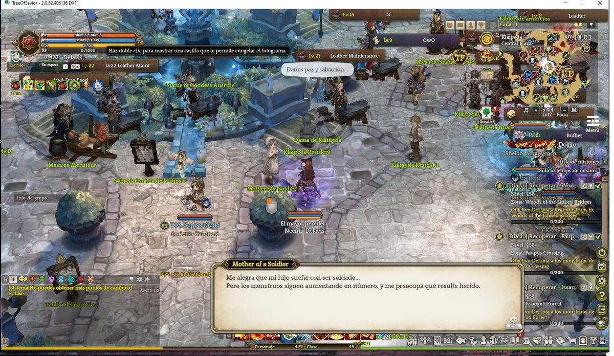
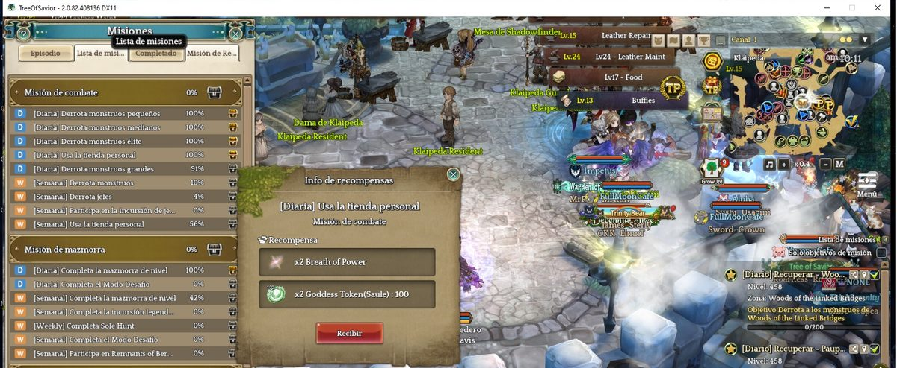
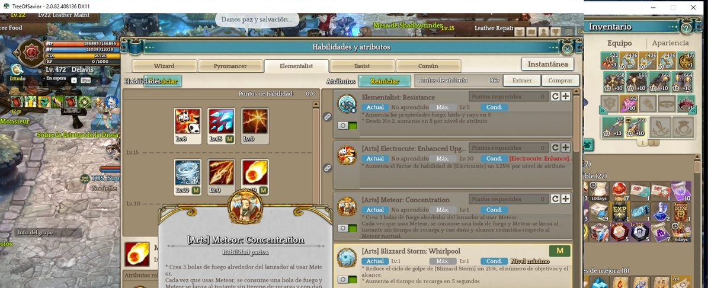
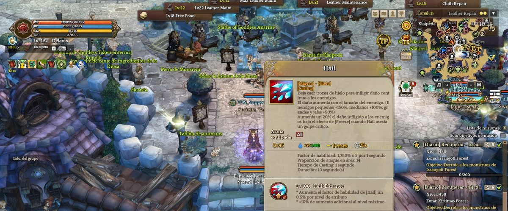
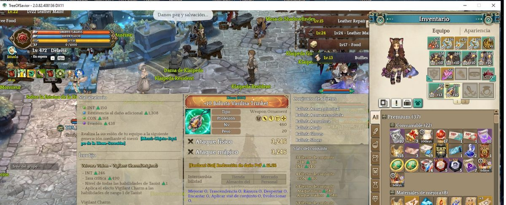
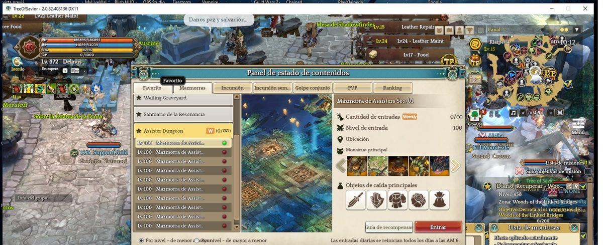
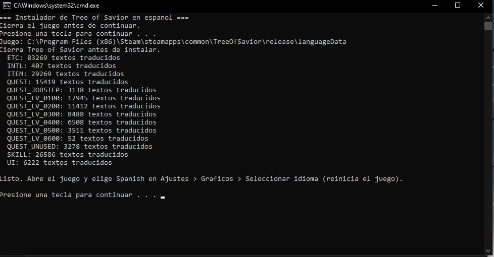

# 🌳 Tree of Savior en español (traducción no oficial)

Traducción al **español latino** del cliente de **Tree of Savior** (versión Steam). Traduce la interfaz,
los mensajes del sistema, toda la historia y las misiones, y las descripciones de habilidades y objetos.

> **Proyecto de fans, sin relación con IMC Games ni Nexon.** El texto original del juego pertenece a
> sus dueños: este repositorio **no** contiene texto en inglés ni en coreano, solo el texto en español
> identificado por el ID de cada línea.

| | |
| :--- | :--- |
| **Versión del parche** | **v1.0** |
| **Fecha** | 26 de octubre de 2026 |
| **Basada en el juego** | revisión **408027** (cliente 2.0.82). Verificada sin textos nuevos hasta la revisión **408142** (cliente 2.0.82.408136) |
| **Idioma / estilo** | español latino neutro, tratamiento de "tú" |
| **Textos traducidos** | 215.504 |
| **Próxima actualización** | se revisará cada **1 a 2 meses**; si IMC agrega contenido nuevo, se traducirá y se publicará una versión nueva |

## 📸 Así se ve








## ✅ Qué incluye la traducción

| Contenido | Archivo del juego | Textos |
| :--- | :--- | ---: |
| Interfaz (menús, botones, ventanas, ajustes) | `UI` | 6.222 |
| Mensajes del sistema | `INTL` | 407 |
| Historia: cambios de clase | `QUEST_JOBSTEP` | 3.138 |
| Historia y misiones, parte 1 | `QUEST_LV_0100` | 17.945 |
| Historia y misiones, parte 2 | `QUEST_LV_0200` | 11.412 |
| Historia y misiones, parte 3 | `QUEST_LV_0300` | 8.488 |
| Historia y misiones, parte 4 | `QUEST_LV_0400` | 6.508 |
| Historia y misiones, parte 5 | `QUEST_LV_0500` | 3.511 |
| Historia y misiones, parte 6 | `QUEST_LV_0600` | 52 |
| Títulos, objetivos y diálogos de misiones | `QUEST` | 15.419 |
| Descripciones de habilidades y atributos | `SKILL` | 26.586 |
| Descripciones de objetos, equipo y eventos | `ITEM` | 29.269 |
| Tutoriales, eventos, avisos y textos varios | `ETC` | 83.269 |
| Misiones sin uso (contenido antiguo) | `QUEST_UNUSED` | 3.278 |

### Lo que se deja en inglés a propósito

- Nombres de **monstruos, NPC, objetos, habilidades, clases, mapas y lugares**.
- Las estadísticas **STR, CON, INT, SPR, DEX**, y términos como **Stamina**, **Casting**, **Buff/Debuff**.
- El filtro de groserías del juego (`BADWORDS`) no se toca.

Así se mantienen los nombres que usa la comunidad y se evitan confusiones al buscar cosas en el juego.

## 🧭 Instalación paso a paso (Windows)

Necesitas tener **Tree of Savior instalado en Steam**. **No hace falta instalar nada más**: el instalador
usa PowerShell, que ya viene con Windows 10 y 11.

1. **Cierra el juego** por completo.
2. **Descarga este repositorio:** botón verde **Code → Download ZIP**.
3. **Descomprime el ZIP** en cualquier carpeta (por ejemplo, el Escritorio). Importante: descomprímelo, no lo
   ejecutes desde dentro del ZIP.
4. Haz **doble clic en `instalar.bat`** y pulsa una tecla cuando te lo pida.
   El instalador busca el juego en la ruta normal de Steam
   (`C:\Program Files (x86)\Steam\steamapps\common\TreeOfSavior`). Si lo tienes en otro disco, te
   pedirá que pegues la ruta de la carpeta `TreeOfSavior`.
5. Verás una lista con los archivos traducidos y el mensaje **"Listo"**.

   

> **¿Windows muestra "Windows protegió su PC"?** Es normal con archivos `.bat` descargados. Pulsa
> **Más información → Ejecutar de todas formas**. Puedes abrir `instalar.bat` e `instalar.ps1` con el Bloc de
> notas para ver exactamente qué hacen: solo copian tu carpeta `English` a `Spanish` y reemplazan el texto.

### Si el doble clic no funciona (instalación con comandos, paso a paso)

A veces Windows bloquea los archivos `.bat`. En ese caso se instala escribiendo un comando. Es fácil:

1. **Abre la carpeta** donde descomprimiste el ZIP (la que contiene `instalar.ps1`, `instalar.bat` y la carpeta `parche`).
2. **Abre PowerShell en esa carpeta:** haz clic en un espacio vacío dentro de la carpeta mientras mantienes
   pulsada la tecla **Shift** (mayúsculas) y elige **"Abrir ventana de PowerShell aquí"**
   (en Windows 11: clic derecho → **"Abrir en Terminal"**).
   - *Otra forma:* pulsa la tecla **Windows**, escribe **`powershell`** y pulsa Enter. Luego escribe `cd ` (con un espacio),
     **arrastra la carpeta descomprimida** dentro de la ventana azul (se escribe sola la ruta) y pulsa Enter.
3. **Copia y pega este comando** (clic derecho dentro de la ventana pega el texto) y pulsa **Enter**:
   ```
   powershell -ExecutionPolicy Bypass -File .\instalar.ps1
   ```
   `Bypass` solo vale para esta ejecución; no cambia nada en tu sistema.
4. Si el juego no está en la ruta normal de Steam, el programa te pedirá la ruta. Para encontrarla: en **Steam**,
   clic derecho sobre *Tree of Savior* → **Administrar → Examinar archivos locales**. Copia la ruta de la barra de
   direcciones de esa carpeta y pégala en la ventana.
5. Espera el mensaje **"Listo"**.

Para **desinstalar** con comandos: `powershell -ExecutionPolicy Bypass -File .\instalar.ps1 -Desinstalar`.

**¿Prefieres hacerlo totalmente a mano, sin ejecutar nada?** No es posible editar a mano las 215.000 líneas, y no
publicamos los archivos ya armados porque incluirían el texto original de IMC; por eso el instalador los arma en tu
PC. (En Linux/Proton o Mac: `python3 instalar.py --juego "RUTA/languageData"`.)

### Poner el juego en español

6. Abre **Tree of Savior**.
7. Abre **Ajustes del juego** (*Game Settings*): botón de engranaje de la barra lateral derecha, o menú ≡ → *Game Settings*.
8. Ve a la pestaña **Gráficos** (*Graphics*) y baja hasta el final: **Seleccionar idioma** (*Select Language*).
9. Elige **Spanish** y pulsa **Guardar**.
10. **Cierra y vuelve a abrir el juego.** Listo: ya está en español.

> Si no te aparece *Spanish* en la lista, el instalador no terminó bien (paso 5) o instalaste con el juego abierto.
> Vuelve a ejecutar `instalar.bat` con el juego cerrado.

## ❓ Problemas comunes

| Problema | Solución |
| :--- | :--- |
| *"Windows protegió su PC"* al abrir `instalar.bat` | Pulsa **Más información → Ejecutar de todas formas**, o usa la instalación con comandos. |
| Aparece *"No encontré la carpeta languageData\English"* | La ruta es incorrecta. Usa la de Steam → *Administrar → Examinar archivos locales* (debe contener la carpeta `release`). |
| *Spanish* no aparece en la lista de idiomas | Instalaste con el juego abierto o el instalador falló. Cierra el juego y vuelve a ejecutarlo. |
| El juego se ve en inglés tras elegir Spanish | Cierra el juego por completo y ábrelo de nuevo (el cambio de idioma pide reiniciar). |
| Quedaron textos en inglés | Son textos nuevos de un parche de IMC. Se traducen en la siguiente versión de la traducción. |
| El instalador dice que falta la carpeta `parche` | Ejecutaste el script desde dentro del ZIP. **Descomprime** el ZIP primero. |

## 🔄 Actualizar

- **Nueva versión de la traducción:** descarga el ZIP de nuevo y vuelve a ejecutar `instalar.bat`.
- **Parche del juego (Steam):** tu carpeta `Spanish` no se borra, pero los textos nuevos que agregue IMC
  aparecerán en **inglés** hasta que salga una versión nueva. Para que el juego use los archivos nuevos
  ejecuta `instalar.bat` otra vez después de cada parche.

## 🗑️ Desinstalar

Haz doble clic en **`desinstalar.bat`** (borra la carpeta `languageData\Spanish`) y elige otro idioma en
los Ajustes del juego. El juego queda exactamente como estaba.

## 🔒 Seguridad

- El instalador **solo crea** la carpeta `languageData\Spanish` copiando tu carpeta `English` y cambiando
  la columna de texto. **No modifica** `English` ni ningún otro archivo del juego.
- Solo trabaja con archivos de texto (`.tsv`), que es la misma vía que usan los idiomas oficiales
  (portugués, alemán, etc.). **No instala addons, DLL ni modifica archivos `.ipf`.**
- Se probó jugando con el anticheat del juego sin ningún aviso. Aun así, úsalo bajo tu propia responsabilidad.

## ⚠️ Limitaciones conocidas

- Algunos textos largos pueden verse cortados en ventanas de tamaño fijo. Se van ajustando.
- En las descripciones largas de habilidades, las palabras se parten a mitad de línea. **Pasa igual en
  inglés**: es una limitación del juego.
- Los textos que IMC agregue después de la revisión 408027 quedan en inglés hasta la próxima versión.
- La traducción se hizo con ayuda de IA y se revisó de forma automática y por muestreo, así que puede haber
  errores o frases poco naturales. Si encuentras alguno, abre un *Issue* indicando el texto y dónde aparece.

## 🤝 Créditos

Traducción asistida por IA (DeepSeek V4.1 Flash) con revisión y herramientas hechas con Claude (Anthropic).
Proyecto de [vickotoAguilera](https://github.com/vickotoAguilera).
